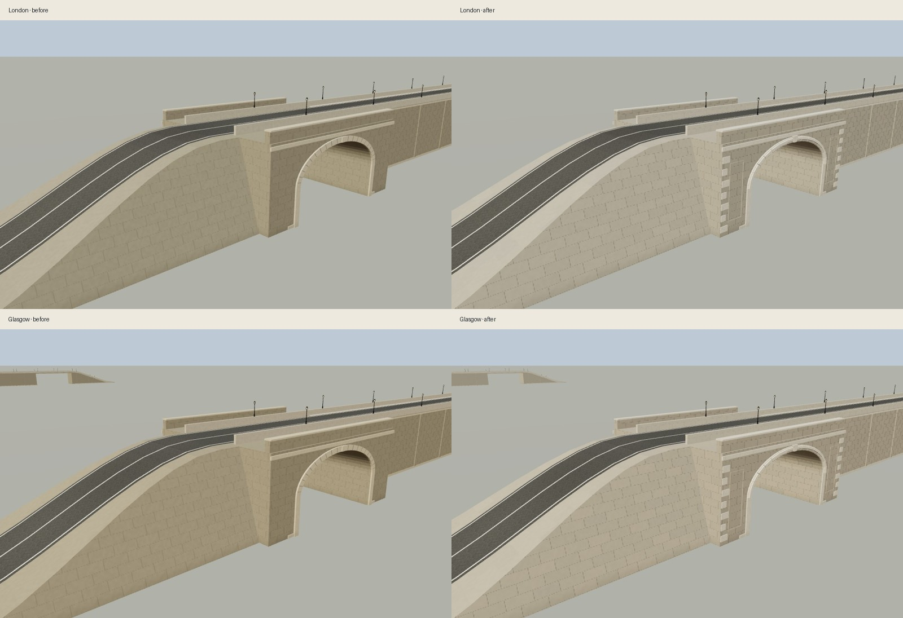
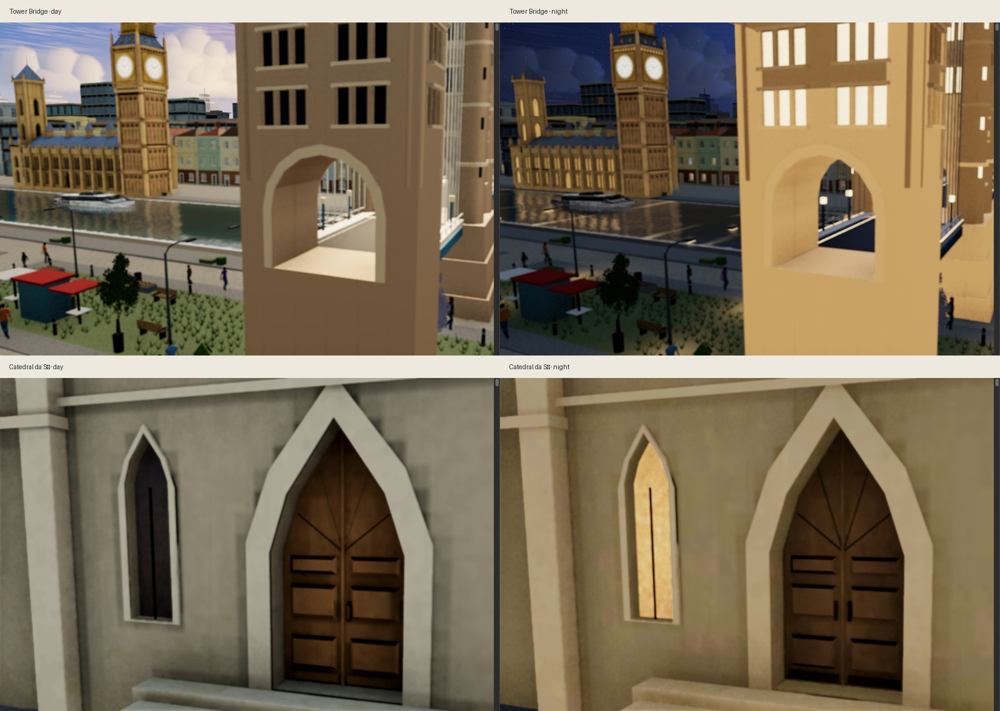

# London/Glasgow bridge finish and landmark portals — 2026-11-12

**Scoped visual/functional GO.** Owner explicitly requested visual improvement of the two existing road bridges and a replacement for solid black portal backgrounds at Tower Bridge and Catedral da Sé. The implementation retains the selected livelier stylized realism. No city expansion, route change, new dependency, dynamic light or render pass.

## Delivered artwork

- **Road bridges:** mineral stone colours, derivative-filtered ashlar joints and surface relief, stepped/rebated stone arch mouldings with individual voussoirs, tapered keystones, corner quoins and restrained pier-panel surrounds. Existing regional tints retain cooler London/slightly warmer Glasgow stone. Merged metric masonry no longer receives the unit-box edge shader that produced inappropriate dark edges. Details merge into the existing geometry buckets.
- **Tower Bridge:** actual open carriageway passages replace blind dark panels through both main and shore towers, at both existing LODs. Two half-vaults meet through each tower. The background is now the real scene beyond the opening; silhouettes, foundations and placement remain fixed.
- **Catedral da Sé:** a recessed two-leaf oak door with six raised panels, meeting stile, bronze pulls/kickplates and a radial upper fan replaces the flat dark fill. Directional oak grain, brighter timber and a restrained baked warm night contribution keep the door readable without adding a light. Gothic stone surround, steps and opening remain fixed.

All landmark authoring sources were updated and GLBs regenerated with the installed Blender/compression toolchain. Cache versions were bumped. Sé retains one opaque atlas material, three KTX2 maps and the existing fixed LOD0 runtime. Tower Bridge retains four materials and zero textures. Project-owned geometry only; provenance is recorded in [ASSET_SOURCES.md](../../ASSET_SOURCES.md).

## Visual evidence

Matched inspection lighting/camera, before on the left and after on the right (these are isolated geometry inspections, not production lighting):

Actual full-scene close-ups, day on the left and night on the right:

Also captured: [375px rain + reduced motion](../evidence/bridges-landmark-portals/mobile-rain.jpg). The portal night inspection prompted a second Sé atlas bake with clearer oak and warm baked bounce; the images and final asset comparison include that revision.

## Bounded cost and preserved contracts

| Item | Before | After |
| --- | ---: | ---: |
| River bridge, each, unique triangles | 5,816 | 7,540 |
| River bridge, each, meshes | 7 | 7 |
| Tower Bridge LOD0 triangles / bytes | 14,144 / 925,316 | 14,072 / 919,556 |
| Tower Bridge LOD1 triangles / bytes | 3,792 / 287,964 | 4,000 / 296,696 |
| Sé LOD0 triangles / bytes | 4,544 / 583,332 | 4,718 / 589,364 |

The three regenerated GLBs total **9,004 additional bytes**. No new texture map, material bucket, lamp, dynamic light or pass. Geometry counts describe unique fixture geometry, not multi-pass submissions or measured frame time. The shader adds surface work; no FPS improvement or unchanged GPU cost is claimed.

Both road decks remain at 7.5 m, with the existing road/asphalt profile, 5.5 m arch half-width, 3.4 m vertical jamb plus 3 m rise, parapet alignment and 28 m exit. Bus/traffic route, livery swap, pedestrian directions/clearance, boat clearance, river banks and 32 lamps are retained. An initial 22-segment arch exceeded the unchanged no-river underpass guard (3,416 > 3,000 triangles). Reducing to 16 segments brought that fixture to 2,936; the guard was not weakened. Tower foundation footprints and water masks are unchanged.

Machine-readable [asset sizes, triangles and SHA256](../evidence/bridges-landmark-portals/asset-comparison.json) and [bridge geometry counts](../evidence/bridges-landmark-portals/bridge-geometry-counts.json) accompany this audit.

## Validation

- Red/green regressions reproduced metric-edge shading and sealed Tower Bridge portals before the fix. Final [focused browser run](../evidence/bridges-landmark-portals/bridges-portals-browser-final.log) passes `bridge-finish`, `landmark-portals`, and the unchanged `river-bridge` and `underpass` suites. Actual Three.js render/shader checks return WebGL `getError() = 0`.
- Portal raycasts traverse all four Tower Bridge towers at both LODs while retaining jambs and vault crowns. Sé raycasts distinguish raised panel depth 6.39 from recessed timber depth 6.30; one opaque atlas mesh is retained.
- Existing landmark asset suites check both Tower Bridge LODs, Sé atlas/maps, bounds, material/triangle contracts and fallback paths; the [final rerun](../evidence/bridges-landmark-portals/bridges-landmark-assets-final.log) passes against the final binaries. Blender export/reimport validation passed; Sé emissive bake check passed 73/73.
- Full-scene Tower Bridge/Sé day and night close-ups: no captured JS errors, failed shader programs or WebGL errors. Actual bridge capture at 375px with rain and reduced motion: same clean result. [Scene log](../evidence/bridges-landmark-portals/landmark-portals-scene.log), [final Sé log](../evidence/bridges-landmark-portals/se-scene-final.log), [mobile log](../evidence/bridges-landmark-portals/bridge-mobile-rain.log).
- Full Node regression: **240 passed, 0 failed, 0 skipped**, [raw output](../evidence/bridges-landmark-portals/bridges-landmark-node-final.log). JS/Python syntax and `git diff --check` passed. No build step exists.
- Independent source review of the shared bridge shader/ownership and landmark authoring/runtime integration found no blocking issue. Review identified an inherited Tower Bridge normal-hint offset in the authoring helper; existing double-sided rendering and the crown/raster checks pass. A general normal-helper rewrite is outside this scoped change.

Not repeated: global FPS/loading A/B, Lighthouse, full EN/PT/WebGL-off matrix or physical-device testing. Copy, panel, loading policy and runtime controls were not changed. This GO covers these visual changes and their tested contracts; physical mobile GPU cost and global production readiness remain unestablished. No push/deployment performed.
