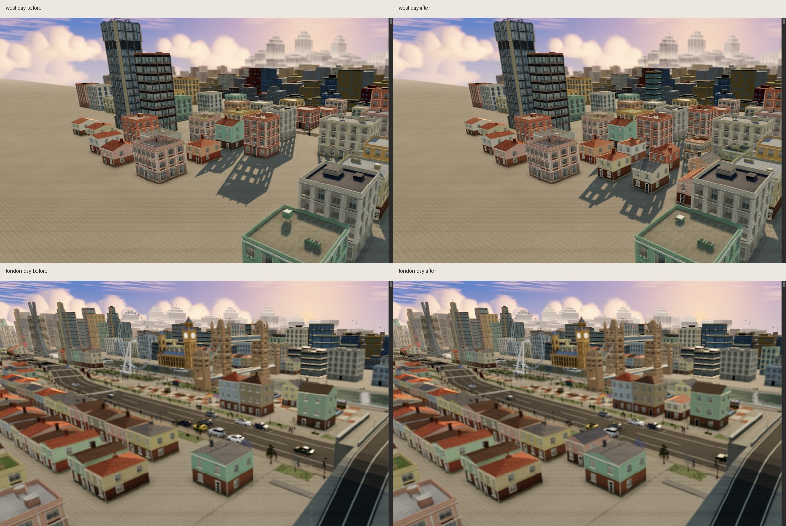

# City density and rendering audit — 2026-11-12

**Scoped visual/functional GO.** The owner authorized further vivid stylized realism, more houses/buildings in usable gaps and an investigation of rendering defects. This pass improves composition and material correctness; it does not establish a maximum attainable realism or a global production-readiness verdict.

## Density and visual composition

`urban-infill.js` appends **27 surveyed lots: 17 houses, two shops, seven residential midrises and one office**. Houses fill selected São Paulo west-side and British transition pockets; taller buildings sit in the rear. Regional families, colours, facade kits and existing full near construction are reused. Heights range from 6.4 to 22.4 m. No new asset family, material, texture, light, dependency or pass.

The list uses real world coordinates and runs after the old legacy generation, parks and gap fill. Its independent RNG cannot shift previous draws. The actual curved-route city grows from **716 to 743 ordinary descriptors**. In the Node linear-route fixture, all **723 previous plot descriptors, 322 trees and 10,630 prop boxes retain their exact hashes**; adding the new lots yields 750. The independent review also checked the new lots against the saved actual-route baseline (716 plots, 315 trees and 10,633 boxes), finding no overlap at the regression margins.

Checks cover existing architecture, trees, raised props, the correctly transformed backdrop, parks/squares, walking areas, old content-anchor reservations, landmark fronts, river-bank buffer and bridge/road circulation. Three return-leg houses were shifted 2 m toward the road after the first browser guard caught their footprints entering the reserved river buffer; that guard was retained. Existing roads, lots, landmark positions, planting and public spaces were not moved.

Matched scene cameras, before left and after right (top: west São Paulo; bottom: London transition). These are real-scene close-ups; the existing bus-focused depth of field remains active. They document density before the separately validated Tower Bridge normal regeneration below.

Additional final checks: [Clyde at night](../evidence/city-density-rendering/clyde-night-after.jpg), [375px rain with reduced motion](../evidence/city-density-rendering/london-mobile-rain-after.jpg), [Tower Bridge day](../evidence/city-density-rendering/tower-towerbridge-day.jpg) and [night](../evidence/city-density-rendering/tower-towerbridge-night.jpg).

## Three rendering defects corrected

1. **Rooftop equipment outside the source envelope.** `shop-slice.js` placed plant above the roof without fitting the available headroom. `block--104-49` reached y=8.30 for a 6.80 m lot. Each selected equipment piece now fits vertically above the unchanged roof, leaving a 0.01 m margin. Floors, facades, roof shapes and deterministic equipment selection remain fixed. The regression covers 770 fixtures / 5,000,304 real geometry vertices, including low/high lots, regions, compositions and both rollout detail levels.
2. **Facade grain rotating with the camera.** The noise was world-anchored but its offset was added directly to a view-space normal. Grain now uses a world tangent/bitangent frame, with a fallback axis on upward/downward surfaces, and transforms the perturbation through `viewMatrix`. Existing strength, scale, fade and AA remain. The actual GPU regression fails before the fix with world-normal drift **0.03339344** and passes after at **0.0000032885** across three material variants, six surface directions and four views through 85 degrees.
3. **Tower Bridge face orientation used a point transform.** The authoring helper included the 5.2 m deck translation in normal hints, reversing some surfaces, including undersides. A direction-only axis transform fixes the sign. A six-face unit-box self-check fails on the original source and passes after correction. Both GLBs were regenerated, manifest hashes refreshed and cache version bumped to 13. Triangle counts, bounds, four materials, open vaults and LOD policy remain fixed. Loaded-asset raycasts now require the vault underside to face downward at both LODs; export/reimport validation passes.

## Validation tooling repaired

After the envelope fix, the old citywide test reached a second inherited problem: it attempted to fingerprint the absent `townhouse-experiment` control. The test now explicitly verifies the exact nine historical IDs and their absence in both current renderers, while a nine-lot synthetic fixture preserves the complete experiment fingerprint comparison. The other ten live controls must exist and match. Original envelope, resource and buffer-budget guards remain intact; streaming checks now exercise initial far aliases and exactly one near-cell preparation.

`tools/capture.py` no longer silently accepts a world that failed to become ready/settled. Its style injection uses a block scope so repeated same-document evaluation cannot redeclare the global `st`. An initial survey's loading-screen image was rejected as evidence; only settled final scenes are used here.

## Measured cost

| Actual-route rollout fixture | Before | After |
| --- | ---: | ---: |
| Converted ordinary lots | 691 | 718 |
| Occupied spatial cells | 194 | 200 |
| Stable mass/trim/glass meshes | 582 | 600 |
| Initial unique triangles | 738,828 | 766,846 |
| Initial attribute buffers | 110.83 MiB | 115.03 MiB |
| Shared materials / maps | 2 / 4 | 2 / 4 |

Thus infill adds **six cells / 18 potential mesh submissions and 4.20 MiB of initial attribute buffers**, with the existing nearest-cell preparation, hysteresis and eviction retained. These are unique geometry/resource measurements, not full-frame draw calls, physical VRAM or field performance. The isolated procedural infill sample (`kits:false`) measures 17 cells / 51 meshes and 164,088 near triangles; its cells overlap existing city cells, so it is not the net city draw cost. Authored kit preparation remains asynchronous.

Tower Bridge LOD0 remains 14,072 triangles (919,556 → 924,452 bytes); LOD1 remains 4,000 triangles (296,696 → 295,832 bytes). Combined asset increase: **4,032 bytes**, with no texture changes. [Machine-readable costs](../evidence/city-density-rendering/costs.json).

One sequential local A/B at 1280×800 / DPR1, clear day, cache disabled and service workers bypassed recorded world-ready 3.762 → 3.412 s and settled 6.360 → 5.586 s. A 120-frame sample after settling recorded median/p95 25.0/58.8 → 15.8/17.6 ms. This is **one diagnostic pair** with unpinned adaptive tiers and compilation/scheduling effects; it cannot establish an attributable FPS improvement or a loading guarantee. It did not reveal an obvious slowdown in that sample. [Raw pair](../evidence/city-density-rendering/perf-final.log).

## Evidence and verdict

- **242 Node tests passed**, zero failures/skips. [Final output](../evidence/city-density-rendering/node-final.log).
- Final browser passes: new infill (actual curved road and both render modes), citywide, shop-envelope, facade-grain, ordinary-finish, facade-realism, architecture-streaming, Tower Bridge asset/fallback, landmark portals, render-resources at 1280px/375px and the real reduced-motion architecture-idle fixture. [Final geometry run](../evidence/city-density-rendering/geometry-final.log), [infill/resources](../evidence/city-density-rendering/infill-resource-final.log), [Tower Bridge](../evidence/city-density-rendering/tower-browser-final.log), [grain](../evidence/city-density-rendering/grain-green-browser.log). Earlier integration logs preserve the failed river-buffer guard and stale test-control discovery; they are not counted as final passing runs.
- Full-scene west/London comparisons, Clyde night, final Tower Bridge day/night and 375px rain/reduced-motion: **WebGL error 0, no lost context, zero failed shader programs and empty captured JS errors**. Full-scene scans found no nonfinite position/normal arrays or world transforms. [Scene checks](../evidence/city-density-rendering/scene-captures.log), [final Tower checks](../evidence/city-density-rendering/tower-scene-final.log), [mobile](../evidence/city-density-rendering/mobile-final.log).
- EN/PT WebGL-disabled startup retains substantive HTML content and empty error arrays. [Fallback check](../evidence/city-density-rendering/fallback-final.log).
- Independent source review of infill/frames/guards/roof fitting and the Tower direction correction found no actionable blocker. JS/Python syntax, preload drift and diff whitespace checks passed.

The prior citywide source-envelope failure is resolved, rather than waived. This GO covers these additions and rendering fixes. Physical phones, physical VRAM, Lighthouse, exhaustive temporal z-fighting coverage and repeated performance distributions were not measured. Fine geometry still aliases in the existing mobile DPR1/medium preset; changing that preset's sampling/bandwidth policy is not part of this pass. No commit, push or deployment performed.

## Requested System Design template

The explicitly invoked template was read and a structural clone prepared outside the repository. Its official document renderer is unavailable: the bundled LibreOffice executable is absent, and reloading workspace dependencies did not restore it. The skill requires rendering and inspecting the result, so no unverified DOCX/PDF is delivered. The repository audit/plan above records the actual design and evidence. [Renderer diagnostic](../evidence/city-density-rendering/document-renderer-unavailable.log).
