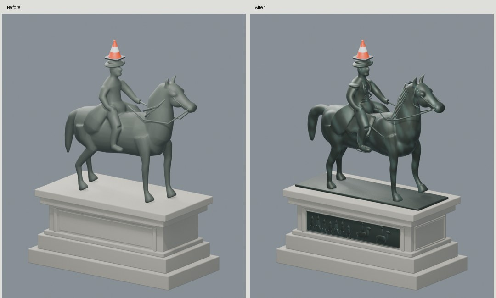

# Wellington, facade finish and lossless performance — 2026-11-14

Baseline: `ef3f975`. Owner order: implement P1 statue and P2 facades first, freeze the completed visual state, then P0 performance without reducing quality or realism. Desktop only; no mobile work. No new dependency, borrowed model or texture. No commit/push in this pass.

## Selected visual changes

Wellington is original Blender-authored geometry guided by actually viewed photographs from [Art UK](https://artuk.org/discover/artworks/equestrian-monument-to-the-duke-of-wellington-254058) ([profile image](https://d3d00swyhr67nd.cloudfront.net/w1200h1200/collection/PUBSCULPT/G1/G1_GB_S038-014.jpg)) and [Exeter, Cast in Stone](https://castinstone.exeter.ac.uk/database/s/en/item/3769) ([three-quarter image](https://castinstone.exeter.ac.uk/database/files/large/04fccd1eed9ca0981e545e455dca9966404e8fc4.jpg)). Photos were temporary visual references; no reference pixels/geometry are distributed. Fuller chest/shoulders/haunches, raised far forehoof, mane/tail, tack, military coat, boots/stirrups and coherent bronze vertex patina replace the earlier broad primitive forms. Stone moldings and original abstract infantry/cavalry reliefs complete the pedestal. The face remains stylized and reliefs do not reconstruct historical battle scenes.

Footprint 5.8×3 m, pedestal top 2.6 m, placement/orientation and traffic cone remain. Three.js bounds: [-2.9000001,0,-1.5] to [2.9317484,7.9000001,1.5]. No new lights/textures/passes. [Five-view authoring methodology and references](../../tools/landmarks/wellington/README.md).

Facades retain their existing regional architecture: eligible opaque townhouse front doors gain raised panels, a letterplate, handle and stone threshold within the original lot. The original mass and glass position arrays remain identical. Shared ordinary room glazing gains subtle contact darkening of the reflection at frame edges, fading at small pixel footprints; interior radiance is unchanged. External kit glass without room/property coordinates and preserved landmark materials are excluded.

Matched five-family daytime/nighttime fixtures retain three calls each. Aggregate geometry: 63,554 → 63,694 triangles (+140 / 0.22%); attribute bytes 10,777,608 → 10,801,128 (+23,520 / 0.22%). Only townhouse trim adds geometry. No extra material/atlas/pass. Existing finishes and property occupancy remain.

[Day comparison](../evidence/wellington-facades/facades-day-comparison.jpg), [night comparison](../evidence/wellington-facades/facades-night-comparison.jpg), [fixture metrics](../evidence/wellington-facades/facades-metrics.json). Left is baseline, right revised. These isolate material/geometry behavior; they are not full-city performance measurements.

## P0 changes and exact-quality evidence

1. `scene.matrixAutoUpdate=false` on the unchanged identity scene root prevents a forced recalculation throughout already-frozen descendants. The explicit world-matrix pass remains before reflections/main rendering. A ready-world sample has 16,527 nodes; matrix multiplications fall 16,526 → 3,593 (12,933 / 78.3% avoided). The regression checks exact matrix equality against the forced baseline, plus movement of a rig/bone and attachment of a new child. This is work avoided, not a 78% frame-time claim. Future transforms of the scene root require explicit matrix update or re-enabling its auto-update.
2. Existing `tools/pipeline/compress-lossless.mjs` reduces the **new** raw Wellington from 2,780,048 to 1,636,452 bytes (−41.14%). Its read-back verification checks decoded attribute bytes, equivalent triangle indices/winding, material properties and scene metadata. Independent review compared 13 accessors / 830,440 decoded values. No simplification, precision reduction or texture change. The editable raw GLB stays alongside the authoring script; rebuilding invokes the same verified compressor. The loader enables the existing Three.js Meshopt decoder before loading and retains its fallback/lifecycle contract.

The statue quality cost is explicit: 14,680 → 90,838 triangles and 415,008 → 1,636,452 delivered bytes compared with the old asset. The scoped statue guard changes from 18k to 100k to cover the owner-authorized sculpt; this is not a performance reduction. Three meshes/materials and zero image textures remain. Source file bytes do not measure physical GPU memory.

No DPR, resolution, samples, shadow quality, geometry detail, population, texture resolution, render distance or visual effects were reduced. Surface-ID packing and recipe caches were left out to keep the runtime change small after the measured work/payload reductions.

## Fixed-quality route measurement

Both samples use `tools/perf/route-profile.py`: 1280×800, DPR 1, fixed high tier, clear day, cache disabled/SW bypass, stops 8.5→11.5, 20 s / 480 scroll steps. P0 baseline already includes the completed statue/facade upgrades. Each tab is closed before the next browser task. Draw-hook counts include reflection/shadow passes.

| Metric | Before P0 | After P0 |
| --- | ---: | ---: |
| Median frame interval | 17.5 ms | 18.6 ms |
| p95 frame interval | 33.3 ms | 33.4 ms |
| Long tasks | 10 | 10 |
| Median draw calls | 1,103 | 1,104 |
| Median submitted triangles, all passes | 10,892,030 | 10,903,665 |

One local pair has timing/scroll/async variation and different heap/GC states. It **does not establish a general FPS improvement**, nor attribute the small median difference to this patch. Reduced matrix work and transfer bytes are verified; the scene remains dominated by substantial rendering workload. No physical VRAM, cold-load latency, GPU profile or cross-device benchmark was performed. [Summary](../evidence/wellington-facades/route-summary.json), raw [before](../evidence/wellington-facades/before-route.json) / [after](../evidence/wellington-facades/after-route.json).

## Verification

- TDD: facade entry regression failed before implementation; matrix-root regression failed before the root change, then passed. A first green attempt hit cached source; rerun explicitly bypassed SW and cache.
- Full Node regression: 264 passed, zero failures. Preload integrity remains passing.
- Browser fixture gates: Wellington decoded model/normals/three renderables/cone bounds/lifecycle/fallback; entries/envelopes/idempotence/day-night shaders; five property-character families; original atlas integrity/1024px ordinary maps. [Final fixture log](../evidence/wellington-facades/final-fixtures.log).
- Runtime matrix equivalence and dynamic/new-node contract: [log](../evidence/wellington-facades/matrix-green.log).
- Desktop content fallback EN/PT with WebGL disabled and PT reduced-motion WebGL: passed, zero captured errors. [Smoke log](../evidence/wellington-facades/smoke.log).
- Authoring scripts and new Python tests compile; `git diff --check` passed.
- Independent connected-code/decoded-GLB review: GO, no concrete blocker. Primary retains visual/runtime responsibility.

Final desktop captures passed at São Paulo (5), London (9.5) and Glasgow (11), day and night: all six report zero captured JS errors, zero failed shader programs and `glGetError()=0`, with 739 plot descriptors preserved. [Contact sheet](../evidence/wellington-facades/city-day-night.jpg), [capture log](../evidence/wellington-facades/city.log). Visual/runtime GO; global FPS gain remains unproven. No mobile/Lighthouse/full historical browser-suite rerun: scoped visual/rendering changes and the owner's no-mobile instruction govern this pass.
